# QA AGENT — MASTER BUILD ROADMAP

> **Phiên bản tài liệu:** 1.0  
> **Ngày lập:** 2026-10-19  
> **Trạng thái khi khởi tạo:** Chưa triển khai  
> **Mục đích:** Giao tài liệu này cho Claude Code để triển khai QA Agent theo từng giai đoạn; Claude phải **tự ghi nhận trạng thái, bằng chứng và nhật ký** trong repository sau mỗi nhiệm vụ, không yêu cầu người dùng tự đánh dấu tiến độ.  
> **Ngôn ngữ code:** TypeScript · **Điều phối:** Claude Code plugin · **Khám phá browser:** Playwright MCP · **Chạy test:** Playwright Test  
> **Hệ điều hành ưu tiên:** Windows (PowerShell), tương thích Linux/macOS khi hợp lý.

---

## 0. HƯỚNG DẪN DÙNG TÀI LIỆU NÀY

### 0.1. Cách khởi động lần đầu (dành cho chủ dự án)

1. Tạo **repository mới, độc lập** tên `qa-agent` và mở thư mục này trong VS Code. **Không bắt đầu bằng cách viết plugin trực tiếp bên trong `chunji-app`**.
2. Lưu tài liệu này tại `<qa-agent>/QA_AGENT_MASTER_ROADMAP.md`.
3. Mở terminal tại root của repository, kiểm tra `git --version`, `node --version`, `npm --version`, `claude --version` (cài công cụ còn thiếu bằng cách chính thức, không chèn token vào command).
4. Chạy `claude` và dán **PROMPT KHỞI TẠO** ở Mục 0.3. Chỉ khởi chạy **Giai đoạn P0** trước.
5. Khi Claude báo P0 đã qua quality gate, xem `docs/PROJECT_STATUS.md`, `docs/WORKLOG.md` và log các lệnh đã thực thi. Sau đó gọi **PROMPT TRIỂN KHAI GIAI ĐOẠN** cho P1, P2, ...
6. Khi mở phiên Claude Code mới, dùng **PROMPT TIẾP TỤC** (Mục 0.4). Không cần tự chỉnh trạng thái dự án.

**Quan trọng:** Claude Code làm việc trong phiên đang chạy; tài liệu này không biến nó thành một dịch vụ nền hoạt động vô hạn. Nếu Claude bị giới hạn phiên, mất quyền truy cập, hoặc cần thao tác nhạy cảm, trạng thái phải lưu thành `BLOCKED` kèm hướng khắc phục, rồi tiếp tục ở phiên sau.

### 0.2. Quy ước phạm vi

- **QA Agent**: plugin và code kiểm thử tổng quát có thể sử dụng ở nhiều dự án.
- **Target App**: ứng dụng được kiểm thử (CHUNJI là ví dụ tích hợp, không phải dependency bắt buộc).
- **Exploration**: Claude + Playwright MCP kiểm tra giao diện và tạo quan sát thực tế.
- **Regression**: Playwright `.spec.ts` có assertions xác định và chạy lặp lại được mà không cần AI click từng bước.
- **MVP**: kết thúc P7. **Phát hành v1.0 / CI/CD**: P8–P9.
- **Definition of Done (DoD)**: chỉ đánh dấu hoàn thành khi có bằng chứng từ lệnh chạy, test, file hoặc tài liệu cụ thể.

### 0.3. PROMPT KHỞI TẠO — copy vào Claude Code lần đầu

```text
Bạn là Lead Engineer, QA Automation Architect và Technical Project Manager của dự án QA Agent.

Hãy đọc TOÀN BỘ file QA_AGENT_MASTER_ROADMAP.md trước khi sửa code. Đây là source of truth về yêu cầu và phạm vi. Mục tiêu là xây dựng một Claude Code Plugin theo mô hình Hybrid: Claude + Playwright MCP để khám phá, Playwright Test để sinh/chạy các test có thể lặp lại, AI để phân tích kết quả.

CHỈ THỰC HIỆN GIAI ĐOẠN P0 ngay bây giờ. Không nhảy sang P1.

Bắt buộc:
1) Kiểm tra môi trường và repo, bảo toàn file có sẵn.
2) Thiết lập cơ chế tiến độ tự động: planning/progress.json là nguồn trạng thái chuẩn; scripts/progress.mjs quản lý cập nhật và render docs/PROJECT_STATUS.md; ghi docs/WORKLOG.md. Tạo CLAUDE.md ngắn gọn để buộc các phiên sau tiếp tục quy trình này.
3) Mỗi task phải cập nhật trạng thái bằng CLI tiến độ khi bắt đầu và khi có kết quả. Không tự đánh dấu DONE nếu chưa có bằng chứng.
4) Chạy tất cả acceptance checks của P0 và lưu log/đường dẫn bằng chứng.
5) Khi xong, tự cập nhật tiến độ, báo tóm tắt, các file thay đổi, lệnh test, kết quả và rủi ro; DỪNG ở cuối P0 để tôi quyết định gọi P1.

Nguyên tắc: TypeScript, code tối giản, an toàn, không sửa dự án CHUNJI; không commit/push/deploy trừ khi tôi yêu cầu; không chạy thao tác phá hủy hay test production. Nếu thiếu thông tin khiến không thể xác nhận nghiệm thu, đánh dấu BLOCKED thay vì giả định.
```

### 0.4. PROMPT TRIỂN KHAI / TIẾP TỤC — sử dụng về sau

**Chạy một giai đoạn (thay `P1` bằng P2...P9):**

```text
Hãy đọc QA_AGENT_MASTER_ROADMAP.md, CLAUDE.md, planning/progress.json,
docs/PROJECT_STATUS.md và docs/WORKLOG.md, sau đó triển khai DUY NHẤT giai đoạn P1.
Tự phân chia và thực thi các task chưa hoàn thành, cập nhật tiến độ bằng
scripts/progress.mjs sau mỗi chuyển trạng thái, kiểm thử và ghi bằng chứng.
Không làm lại phần đã nghiệm thu nếu không có lý do kỹ thuật. Không chuyển
sang giai đoạn kế tiếp. Nếu bị block, ghi blocker rõ ràng; khi hoàn thành,
chạy quality gate, cập nhật tài liệu, báo cáo kết quả, rồi dừng.
```

**Tiếp tục khi Claude hết context / mở session mới:**

```text
Tiếp tục dự án QA Agent từ trạng thái lưu trong repository. Trước tiên đọc
QA_AGENT_MASTER_ROADMAP.md, CLAUDE.md, planning/progress.json,
docs/PROJECT_STATUS.md và phần cuối docs/WORKLOG.md. Xác định giai đoạn đang
IN_PROGRESS/BLOCKED, kiểm tra git diff và evidence, tiếp tục đúng task còn dang
dở. Không tự tuyên bố test pass nếu chưa chạy lại được. Tự cập nhật tiến độ
trong repository như quy định; không nhảy phase.
```

**Kiểm tra tiến độ bất kỳ lúc nào:**

```text
Hãy đọc planning/progress.json và docs/PROJECT_STATUS.md; tóm tắt tiến độ
QA Agent, phase đang làm, task bị block, bằng chứng đã xác minh và lệnh
khởi chạy phase kế tiếp. Không sửa trạng thái chỉ để làm báo cáo đẹp.
```

---

## 1. MỤC TIÊU SẢN PHẨM, GIỚI HẠN VÀ TIÊU CHÍ THÀNH CÔNG

### 1.1. User journey chuẩn

```
User đưa scope cần test
   ↓
QA Agent đọc config + tài liệu + source code
   ↓
Claude dùng Playwright MCP khám phá UI (chỉ môi trường được phép)
   ↓
Trích xuất requirement + xây test case matrix có traceability
   ↓
Kiểm tra những expected result chưa đủ căn cứ → NEEDS_REVIEW/BLOCKED
   ↓
Sinh spec TypeScript, fixtures và assertions có căn cứ
   ↓
Playwright Test chạy suite, phân phối workers an toàn
   ↓
Thu screenshots / traces / structured results
   ↓
AI phân tích lỗi, phân loại confidence + xuất report
   ↓
Cập nhật tiến độ và báo cáo trong repo
```

### 1.2. MVP phải làm được

- Load QA Agent như một **Claude Code plugin thật**, có tối thiểu Skills `discover`, `plan`, `generate`, `run`, `report`, `full-test`.
- Đọc **một web app mẫu độc lập** (fixture/demo an toàn); tạo project map và test matrix có `requirementRef`.
- Sinh và thực thi **10–20 test case có căn cứ** trên một workflow, gồm happy path, negative, boundary, RBAC (tùy những case có đủ requirement và dữ liệu).
- Kiểm thử **ít nhất 2 role**, mở nhiều tab nhưng dùng browser contexts riêng khi cần tách session.
- Sinh `.spec.ts` có thể chạy lại trực tiếp qua `npx playwright test` mà không cần AI ở thời điểm execution.
- Có kết quả PASS/FAIL/SKIPPED/BLOCKED/NOT_RUN, evidence, Markdown summary, JSON report và HTML report.
- Mọi tiến độ được cập nhật **bằng code trong repository**; phiên mới có thể resume từ file lưu trữ.

### 1.3. Ngoài phạm vi MVP

- Không hứa tìm ra **100% mọi test case** hoặc 100% bug.
- Không làm custom browser engine / custom MCP server khi Playwright MCP hiện có đáp ứng yêu cầu.
- Không làm dashboard SaaS, multi-tenant, self-healing không kiểm soát, load test, pentest chuyên sâu hoặc hỗ trợ hàng trăm workers.
- Không triển khai bất kỳ chức năng chỉ vì AI suy đoán khi thiếu requirement.
- Không sửa source nghiệp vụ của Target App để ép test PASS.

### 1.4. Định nghĩa MVP thành công (có đo lường)

1. Plugin validation PASS; skills gọi được trong Claude Code.
2. Test matrix liên kết ngược đến requirement thật/đã định nghĩa trong fixture; case chưa rõ ở trạng thái NEEDS_REVIEW.
3. Có ít nhất 01 E2E workflow với 02 browser contexts cho 02 role, có ít nhất 01 negative/RBAC case chạy được.
4. `npx playwright test` chạy được trong môi trường được phép; có kết quả report.
5. Fixture workflow có thể chạy lặp lại tối thiểu **3 lần** trên môi trường sạch; flaky phải được ghi chứ không che giấu.
6. `planning/progress.json` và `docs/PROJECT_STATUS.md` đồng bộ, có thể kiểm tra bằng CLI.
7. README đủ hướng dẫn một lập trình viên khác cài và chạy thử mà không cần hiểu lịch sử chat.

---

## 2. QUY ƯỚC KỸ THUẬT VÀ CẤU TRÚC REPOSITORY

### 2.1. Stack ban đầu

| Lớp | Công nghệ | Ghi chú |
|---|---|---|
| Runtime | Node.js phiên bản LTS còn được hỗ trợ | Xác nhận phiên bản thực tế trong P0 |
| Language | TypeScript (strict) | Ưu tiên Node-compatible tooling |
| Plugin | Claude Code Plugin: `.claude-plugin/plugin.json` | Skills và Agents theo docs chính thức |
| AI browser explorer | `@playwright/mcp` | Dùng package/CLI đã kiểm chứng, **pin version** sau spike |
| Deterministic runner | `@playwright/test` | Chromium trước, mở rộng browser sau |
| Validation | Zod / JSON Schema | Dùng 1 source schema, test schema versioning |
| Persistence MVP | JSON + Markdown trong repo | Chưa cần PostgreSQL |
| Testing engine unit tests | Vitest hoặc Node test runner | Chọn 1 công cụ trong P0, không thêm cả hai vô cớ |
| Lint/format | ESLint + Prettier hoặc bộ công cụ tương đương | Chọn nhất quán, phù hợp môi trường |

**Quy tắc:** Không hardcode secret; không tự cài package global khi có local alternative; không thêm framework chỉ vì được đề cập trong kế hoạch.

### 2.2. Cấu trúc đích (phát triển dần, không tạo folder rỗng hàng loạt)

```text
qa-agent/
├── QA_AGENT_MASTER_ROADMAP.md       # kế hoạch tĩnh, chỉ sửa khi có thay đổi phạm vi
├── CLAUDE.md                        # hướng dẫn hành vi ngắn, tự load trong repo
├── .claude-plugin/plugin.json       # plugin manifest
├── .mcp.json                        # Playwright MCP connection
├── skills/
│   ├── discover/SKILL.md
│   ├── plan/SKILL.md
│   ├── generate/SKILL.md
│   ├── run/SKILL.md
│   ├── report/SKILL.md
│   └── full-test/SKILL.md
├── agents/                           # agent chuyên trách, chỉ thêm khi có lợi ích
│   ├── requirement-analyst.md
│   └── failure-analyzer.md
├── src/
│   ├── contracts/                   # schemas, state, errors
│   ├── config/                      # project adapters, project config
│   ├── discovery/                   # app map + discovered observations
│   ├── planning/                    # test matrix / dependency logic
│   ├── generator/                   # spec/fixture generator
│   ├── sessions/                    # contexts / account isolation
│   ├── orchestrator/                # sequencing, retries, budgets
│   ├── evidence/                    # traces, screenshots, artifacts
│   └── reporting/                   # normalize reporter outputs
├── scripts/
│   ├── progress.mjs                 # CLI cập nhật state + render Markdown
│   └── ...
├── planning/
│   └── progress.json                # SINGLE SOURCE OF TRUTH cho tiến độ
├── docs/
│   ├── PROJECT_STATUS.md            # AUTO-GENERATED, không sửa tay
│   ├── WORKLOG.md                   # append-only decisions + hành động
│   ├── ADR/                         # architectural decision records
│   └── PHASE_REVIEWS/               # evidence / gate reviews
├── examples/
│   └── sample-app/                  # target app thử nghiệm được phép
├── tests/
│   ├── unit/
│   ├── integration/
│   └── e2e/
├── templates/
├── package.json
├── tsconfig.json
└── README.md
```

### 2.3. Ranh giới giữa plugin và target app

- Repository `qa-agent`: chứa engine, schemas, skill definitions và dự án demo.
- Target App: chỉ chứa `.qa-agent/config.json`, test cases phát sinh, specs và output khi được chủ dự án cho phép.
- Mặc định **read-only** với source code của target app; chỉ ghi vào thư mục đã allowlist (`.qa-agent/`, `e2e/generated/`, `qa-artifacts/`), không tự sửa business logic.
- Tài liệu `Chunji-document` nếu dùng phải **read-only**.
- Nếu thiếu CHUNJI hoặc thiếu credentials, không được tự bịa API, role, trạng thái workflow. Chạy demo và ghi `BLOCKED` cho integration thật.

---

## 3. HỆ THỐNG CẬP NHẬT TIẾN ĐỘ TỰ ĐỘNG — PHẢI XÂY DỰNG TRONG P0

> **Đây là thành phần bắt buộc, không phải việc phụ.** Mục tiêu: người dùng chỉ giao task/phase; Claude tự ghi trạng thái, không cần người dùng sửa checkbox.

### 3.1. Nguồn dữ liệu và các file

| File | Vai trò | Ai cập nhật |
|---|---|---|
| `planning/progress.json` | Nguồn trạng thái duy nhất (task, phase, evidence, blockers) | `scripts/progress.mjs` |
| `docs/PROJECT_STATUS.md` | Dashboard Markdown render từ progress.json | Script tự sinh, **không chỉnh tay** |
| `docs/WORKLOG.md` | Nhật ký append-only: làm gì, vì sao, kết quả nào | Script/Claude theo quy trình, không xoá lịch sử |
| `docs/PHASE_REVIEWS/Px.md` | Evidence và quyết định nghiệm thu từng phase | Claude khi chạy gate |
| `CLAUDE.md` | Quy tắc phải đọc/cập nhật tiến độ ở mỗi session | Claude tạo trong P0 và dùng trong các phiên sau |
| `QA_AGENT_MASTER_ROADMAP.md` | Roadmap và acceptance criteria chuẩn | Không thay đổi để giả vờ đã hoàn thành |

### 3.2. Schema trạng thái (mẫu; P0 hiện thực và kiểm tra bằng JSON Schema/Zod hoặc validation nhất quán)

```json
{
  "schemaVersion": 1,
  "project": "qa-agent",
  "activePhase": "P0",
  "updatedAt": null,
  "phases": {
    "P0": {
      "title": "Bootstrap and Progress Tracking",
      "status": "not_started",
      "gate": "pending",
      "tasks": {
        "P0-T01": {
          "title": "Inspect environment and repository",
          "status": "not_started",
          "evidence": [],
          "blockers": []
        }
      }
    }
  }
}
```

P0 phải seed **toàn bộ task IDs từ P0–P9** theo roadmap này; không chỉ ghi P0. Có thể bổ sung trường `startedAt`, `completedAt`, `checks`, `notes`, `lastAttemptAt`, `owner`, nhưng phải có migration/schemaVersion.

**Task statuses:** `not_started`, `in_progress`, `completed`, `blocked`.  
**Phase statuses:** `not_started`, `in_progress`, `completed`, `blocked`.  
**Gate:** `pending`, `passed`, `failed`, `blocked`.

**Không đánh dấu `completed` nếu `evidence` rỗng.** Evidence phải thể hiện command + exit code, tên file hoặc test output cụ thể, không chỉ viết “đã test”. Gate `passed` cần review file và mọi task bắt buộc hoàn tất/được xử lý theo chính sách chính thức.

### 3.3. CLI tiến độ bắt buộc (P0 implement giao diện này)

```powershell
node scripts/progress.mjs init
node scripts/progress.mjs start P0 P0-T01
node scripts/progress.mjs complete P0 P0-T01 --evidence "git status --short: exit=0"
node scripts/progress.mjs block P0 P0-T02 --reason "Node runtime unavailable"
node scripts/progress.mjs gate P0 passed --evidence "docs/PHASE_REVIEWS/P0.md"
node scripts/progress.mjs render
node scripts/progress.mjs check
node scripts/progress.mjs summary
```

**Yêu cầu CLI:**

1. `init` idempotent: tạo state theo đúng task IDs, không xoá tiến độ có sẵn.
2. Validate phase/task ID, statuses, evidence, path; transition không hợp lệ trả exit code khác 0.
3. `complete` chỉ chấp nhận evidence cụ thể; `gate passed` chỉ khi task bắt buộc đã complete, file gate review tồn tại và `check` thành công.
4. Ghi state an toàn (atomic write: temp + rename; xử lý lỗi) và có kiểm tra cạnh tranh/corruption ít nhất ở mức cần cho local MVP.
5. Sau **mỗi update hợp lệ**, tự render `docs/PROJECT_STATUS.md` và append sự kiện `docs/WORKLOG.md` (timestamp ISO, phase, task, action, evidence, outcome).
6. `check` kiểm tra schema, task inventory P0–P9, tính hợp lệ transitions/current gate và sự đồng bộ nội dung status Markdown (không cần sử dụng LLM).
7. `summary` hiển thị tiến độ thật, task đang làm, task blocked, gate mới nhất; phần trăm = task hoàn thành / tổng task, **không** được đồng nghĩa với test coverage.
8. Script phải hoạt động với Windows/PowerShell và Linux, không dùng Bash-only idioms.
9. Có unit tests cho `init`, `start`, `complete`, `block`, `gate`, `render`, `check`, corruption/invalid transition, resume.

### 3.4. Chính sách cập nhật của Claude Code

**Trước mỗi task:** gọi `progress start`; kiểm tra đầu vào. **Ngoại lệ bootstrap P0-T01..P0-T04:** khi CLI chưa được tạo, ghi dấu vết thực tế vào log tạm `docs/BOOTSTRAP_LOG.md`; ngay khi CLI hoạt động, nhập lại lịch sử đúng theo bằng chứng gốc (không tạo timestamp giả) rồi chuyển sang quy trình chuẩn.  
**Trong task:** tạo code, test, xử lý lỗi; ghi quyết định kỹ thuật đáng kể vào WORKLOG.  
**Ngay sau test/check:** ghi command, exit code và đường dẫn artifact.  
**Khi task đã đạt DoD:** gọi `progress complete --evidence ...`.  
**Nếu vướng điều kiện khách quan:** gọi `progress block --reason ...`, lưu cách unblock; không đánh dấu complete.  
**Cuối phase:** tạo `docs/PHASE_REVIEWS/Px.md`, chạy progress check, gọi `gate Px passed` chỉ khi đủ bằng chứng; báo cáo và **dừng**, không chạy sang phase khác.  
**Khi resume:** ưu tiên progress.json + git diff + artifacts; không dựa vào trí nhớ hội thoại để xác định trạng thái.

**Lưu ý:** Không chỉnh trực tiếp `progress.json`/`PROJECT_STATUS.md` thay CLI trừ khi đang sửa bug của chính CLI và đã để lại log sửa chữa.

### 3.5. CLAUDE.md mà P0 phải tạo (ngắn gọn, <200 dòng)

```markdown
# QA Agent — Engineering Rules

- Read `QA_AGENT_MASTER_ROADMAP.md` and `planning/progress.json` before work.
- Execute only the phase explicitly requested by the user.
- Track every task with `node scripts/progress.mjs`; never edit generated status by hand.
- Before task: `start`. After verified completion: `complete --evidence`.
- On blockers: `block --reason`; do not fabricate success.
- Before saying a phase is done, run acceptance commands, create `docs/PHASE_REVIEWS/Px.md`, run `progress check`, and pass the phase gate.
- Stop after the requested phase; report changes, executed tests, failures and next prompt.
- Never change production/business code or protected project docs to make tests pass.
- No secrets in Git or reports. No production/destructive tests without explicit approval.
- Use TypeScript strict; prefer small, tested modules; no unnecessary dependencies.
- Keep `QA_AGENT_MASTER_ROADMAP.md` stable; propose scope change as ADR, not by silently removing requirements.
- No git commit, push, deployment, or package publish without explicit user permission.
```

**Hooks:** Có thể thêm `SessionStart` để nhắc đọc trạng thái và `Stop` để kiểm tra consistency về sau; nhưng hook **không được giả vờ tự xác định task PASS**. Chỉ dùng hooks khi đã kiểm chứng API hook chính thức, tránh vòng lặp Stop liên tục. Cơ chế chuẩn vẫn là CLI tiến độ + gate.

---

## 4. PHASE-BY-PHASE EXECUTION ROADMAP

> Quy tắc: thực thi đúng thứ tự P0 → P1 → … → P9. Mỗi phase có checklist task ID cố định, sản phẩm bàn giao và acceptance gates. Claude xử lý toàn bộ checklist thuộc phase được yêu cầu rồi dừng.

### P0 — BOOTSTRAP & AUTOMATED PROGRESS [BẮT BUỘC LÀM ĐẦU TIÊN]

**Mục tiêu:** Repository có nền tảng kỹ thuật và hệ thống quản lý tiến độ tồn tại độc lập với phiên chat.

**Task checklist:**

- [ ] **P0-T01** — Audit hệ thống: git/node/npm/claude, OS, package manager, quyền truy cập; ghi phiên bản và các điều kiện thiếu.
- [ ] **P0-T02** — Khởi tạo `package.json`, TypeScript strict, scripts `lint`, `typecheck`, `test`, `build` (chỉ những script có implementation thật), `.gitignore`, `.editorconfig`.
- [ ] **P0-T03** — Tạo `planning/progress.json` chứa đầy đủ P0–P9 task IDs/status khởi tạo. Không giả vờ CLI đã tồn tại trước P0-T04; xem ngoại lệ bootstrap §3.4.
- [ ] **P0-T04** — Viết `scripts/progress.mjs` với các lệnh bắt buộc ở §3.3, tự render status/log, validation, error handling.
- [ ] **P0-T05** — Viết unit tests cho progress CLI (success, failure, invalid transition, idempotency, corruption/resume).
- [ ] **P0-T06** — Tạo `CLAUDE.md`, `README.md` ban đầu, `docs/PROJECT_STATUS.md`, `docs/WORKLOG.md`, docs review; hợp nhất `docs/BOOTSTRAP_LOG.md` theo evidence rồi lưu bản gốc; không lặp toàn bộ roadmap trong CLAUDE.md.
- [ ] **P0-T07** — Chạy toàn bộ acceptance checks, lưu evidence, fix lỗi, viết phase review, xác nhận stop/resume của CLI. Đánh dấu task complete trước; **sau đó** mới gọi `progress gate P0 passed` để tránh vòng phụ thuộc.

**GATE P0 — PASS nếu:**
- `npm run typecheck`, `npm test`, `npm run lint` (hoặc lệnh tương đương được ghi chính xác) PASS.
- `node scripts/progress.mjs check` PASS; `render` idempotent.
- Dùng temp fixture/state để mô phỏng một task hoàn thành và bị block, status Markdown thay đổi chính xác, không phá state thật.
- `docs/PHASE_REVIEWS/P0.md` chứa các lệnh, exit code và kết quả; P0 phase `completed`, gate `passed`.

**Nếu thiếu Claude CLI / npm:** Ghi blocker và hướng cài đặt, không giả vờ đã kiểm thử các lệnh không tồn tại.

### P1 — CLAUDE CODE PLUGIN FOUNDATION

**Mục tiêu:** QA Agent load được thành plugin và liên kết browser tools.

**Task checklist:**

- [ ] **P1-T01** — Đọc docs Claude Code plugin mới nhất, tạo `.claude-plugin/plugin.json` hợp lệ.
- [ ] **P1-T02** — Tạo 6 Skill skeletons `discover`, `plan`, `generate`, `run`, `report`, `full-test` với frontmatter đúng format; scope rõ, chưa khẳng định tác vụ chưa implemented hoạt động.
- [ ] **P1-T03** — Tạo `.mcp.json` tích hợp Playwright MCP theo upstream và xác minh tool loading; pin version dependency sau khi chứng minh tương thích.
- [ ] **P1-T04** — Viết adapter cho plugin path, project root, config discovery; test đường dẫn Windows có khoảng trắng.
- [ ] **P1-T05** — Smoke test plugin validate/load, skill discovery, MCP availability, và ghi limitations.
- [ ] **P1-T06** — Quality gate, docs/README và phase review P1.

**GATE P1 — PASS nếu:** `claude plugin validate .` PASS; `claude --plugin-dir .` load được plugin (thực nghiệm hoặc ghi rõ `BLOCKED` nếu CLI environment không cho kiểm chứng); gọi được tối thiểu `discover` skeleton; Playwright MCP trả được một observation ở demo page hoặc ghi blocker nếu browser unavailable. **Không tuyên bố MCP chạy nếu mới chỉ viết JSON.**

### P2 — TARGET CONFIG, DISCOVERY & SAFE BROWSER EXPLORATION

**Mục tiêu:** Nắm được cấu trúc ứng dụng và behavior thực tế mà không suy diễn expected result.

**Task checklist:**

- [ ] **P2-T01** — Thiết kế `project-config.schema.ts`: `projectId`, framework (optional), baseURL, allowedOrigins, docsPaths, sourcePaths, testOutputRoot, readOnlyPaths, roles references, worker budgets.
- [ ] **P2-T02** — Xây cấu phần đọc source/docs an toàn, exclude secrets, binaries, node_modules, test artifacts; giới hạn phạm vi và kích thước.
- [ ] **P2-T03** — Trích xuất/đề xuất project map: routes, forms, interactive UI, role hints, API references; gắn nguồn và confidence cho từng observation.
- [ ] **P2-T04** — Thực hiện live browser exploration thông qua MCP trong allowedOrigin, ghi selectors/observations, hạn chế mutation, timeout/retry hợp lý.
- [ ] **P2-T05** — Xuất `project-map.json`, `observations.json`; phân biệt `observed`, `source-derived`, `hypothesized`.
- [ ] **P2-T06** — Unit/integration tests với sample app, permission guard, URL allowlist; review P2.

**GATE P2 — PASS nếu:** Từ demo app, discover xuất manifest hợp lệ; có thể truy từ một route/element về nguồn quan sát; URL ngoài allowlist bị từ chối; source không chứa secret; không có mutation trái phép.

### P3 — REQUIREMENTS & TEST PLANNING ENGINE

**Mục tiêu:** Sinh test case có cấu trúc và biết rõ căn cứ nghiệp vụ.

**Task checklist:**

- [ ] **P3-T01** — Xây schema `Requirement`, `TestScenario`, `TestCase`, `TestPlan` có schemaVersion, IDs, preconditions, actors, actions, expectations, priority, category, provenance, blockers.
- [ ] **P3-T02** — Requirements mapper từ docs/code/observations. Không lấy UI hiện hành làm chứng cứ duy nhất cho expected results.
- [ ] **P3-T03** — Sinh matrix: happy path, negative, boundary, RBAC, state transition, network failure, concurrency (nếu có yêu cầu).
- [ ] **P3-T04** — Deduplicate theo hành vi/expected outcome; chấm điểm rủi ro P0/P1/P2 và dependencies.
- [ ] **P3-T05** — Xác định statuses `DRAFT`, `NEEDS_REVIEW`, `READY`, `BLOCKED`; case không đủ căn cứ không tự động vào runner.
- [ ] **P3-T06** — Export versioned JSON + human-readable Markdown/CSV (nếu cần), test schema invalid inputs và review P3.

**GATE P3 — PASS nếu:** Với demo requirements đã biết trước, test planner tạo được nhóm case hợp lý, assertions có căn cứ, requirement traceability kiểm tra được; thiếu expected result thì `NEEDS_REVIEW`, không giả lập kết quả đúng. Có tests cho duplicate và dependency cycle.

### P4 — PLAYWRIGHT CODE GENERATION ENGINE

**Mục tiêu:** Test plan → test code thực sự compile được, dễ bảo trì.

**Task checklist:**

- [ ] **P4-T01** — Generator nhận test cases `READY` đã validate, tạo `.spec.ts` theo template có deterministic naming và ID mapping.
- [ ] **P4-T02** — Sinh locators ưu tiên `getByRole`, `getByLabel`, `getByTestId`; tuyệt đối tránh CSS brittle nếu có locator ổn định.
- [ ] **P4-T03** — Hỗ trợ assertions có ý nghĩa nghiệp vụ: UI states, response status, persistence, RBAC; không chỉ assert URL hay page visible.
- [ ] **P4-T04** — Test fixtures/page helpers tái sử dụng; data setup/teardown, stable unique IDs cho fixtures.
- [ ] **P4-T05** — Validate generated code bằng formatter, TypeScript compile, Playwright test discovery `--list` và unit tests snapshot/golden files.
- [ ] **P4-T06** — Generator idempotent (lặp lại không phá custom tests), vùng output rõ, review P4.

**GATE P4 — PASS nếu:** từ fixture test-plan tạo `.spec.ts` compile được; `npx playwright test --list` thấy các case; regeneration cho output ổn định; không viết ngoài output allowlist; không tự sửa assertions để che lỗi.

### P5 — AUTH, MULTI-TAB, MULTI-ROLE & TEST ORCHESTRATION

**Mục tiêu:** Điều khiển nhiều role và tab an toàn, không tạo session/race condition giả.

**Task checklist:**

- [ ] **P5-T01** — Thiết kế role/account references (không lưu credentials plaintext); auth setup/refresh có kiểm soát.
- [ ] **P5-T02** — Session Manager: per-role BrowserContext, per-context tabs, cleanup trong `finally`/fixtures.
- [ ] **P5-T03** — Workflow scheduler: steps/dependency graph, đồng bộ observable states, timeouts, retries hợp lý.
- [ ] **P5-T04** — Worker budget + data isolation: mặc định workers=1 cho write-heavy demo, tăng 2 khi chứng minh độc lập.
- [ ] **P5-T05** — Test role A tạo dữ liệu → role B duyệt → role A thấy kết quả; test forbidden action và session isolation.
- [ ] **P5-T06** — Test teardown/resource leaks, cancelled runs, unexpected browser errors; review P5.

**GATE P5 — PASS nếu:** workflow 2 role dùng contexts độc lập; session không leak giữa role; một action được kiểm tra bằng trạng thái hợp lệ hoặc API theo requirement; dữ liệu test cleanup được; không có shared-account collision khi parallel.

### P6 — END-TO-END HYBRID VERTICAL SLICE (MVP CORE)

**Mục tiêu:** Chứng minh toàn pipeline cho **một luồng nghiệp vụ thực sự**.

**Task checklist:**

- [ ] **P6-T01** — Xây demo app/harness nhỏ hoặc dùng sample app được phép với 2 roles, một approval-like workflow, fixtures/seed data, rõ requirements. Không dựng backend phức tạp chỉ để phô diễn.
- [ ] **P6-T02** — Chạy pipeline `discover → plan → generate → run` trên demo; lưu intermediate artifacts có version.
- [ ] **P6-T03** — Chạy tối thiểu 1 happy path, 1 negative, 1 RBAC, 1 boundary (nếu docs demo hỗ trợ); mục tiêu 10–20 case có giá trị, không thêm case giả để đủ số.
- [ ] **P6-T04** — Kiểm thử hai role + multi-tab; CI/non-interactive Playwright runner chạy mà không cần gọi AI cho từng click.
- [ ] **P6-T05** — Dựng một intentional bug trong demo/test fixture và xác nhận engine FAIL đúng; sau đó hoàn nguyên fixture.
- [ ] **P6-T06** — Chạy lặp lại tối thiểu 3 lần trên state sạch, ghi flake/failure, review P6.

**GATE P6 — PASS nếu:** vertical slice thành công ở sample app; có Playwright specs, logs và artifact; intentional bug được phát hiện thật; ít nhất 2 contexts và meaningful business assertions; 3 lần run có kết quả lưu đầy đủ. Nếu CHUNJI chưa sẵn sàng, không để điều đó block việc nghiệm thu demo.

### P7 — EVIDENCE, REPORTING & MVP RELEASE CANDIDATE

**Mục tiêu:** Có thể tin tưởng, debug và truyền đạt kết quả QA.

**Task checklist:**

- [ ] **P7-T01** — Evidence collector: Playwright JSON + HTML report, trace on failure, screenshots, runtime metadata (không lộ secret).
- [ ] **P7-T02** — Normalize results: `PASS`, `FAIL`, `SKIPPED`, `BLOCKED`, `NOT_RUN` + duration + browser + build hash + case ID.
- [ ] **P7-T03** — AI Failure Analyzer trả `probable_app_bug`, `test_automation_issue`, `environment_issue`, `insufficient_evidence` cùng rationale/evidence/confidence. AI không rewrite test/expected result tự ý.
- [ ] **P7-T04** — Requirements coverage report: links từ requirement → test cases → executions; phân biệt count generated/executed/passed.
- [ ] **P7-T05** — Lệnh report và `full-test` phối hợp các stage, hỗ trợ recover/resume, tạo Markdown executive summary.
- [ ] **P7-T06** — README Getting Started, config guide, demo walkthrough, `docs/PHASE_REVIEWS/P7.md`, final MVP gate.

**GATE P7 — MVP PASS nếu:** run có HTML, JSON, Markdown summary, evidence cho failed case; các trạng thái tách bạch; report link tới case ID; full-test run khả dụng; README theo được trên một máy mới (hoặc reproducible clean environment); toàn bộ gates P0–P7 pass.

### P8 — HARDENING, SECURITY & CROSS-PROJECT TESTING [SAU MVP]

**Mục tiêu:** Đưa MVP thành tool đủ tin cậy để sử dụng rộng hơn.

**Task checklist:**

- [ ] **P8-T01** — Threat model: sensitive cookies/storageState, secrets, prompt injection từ web/docs, exfiltration qua report, path traversal.
- [ ] **P8-T02** — Enforcement cho origin/path allowlist, read-only target docs, policy đối với mutations/destructive operations; test negative cases.
- [ ] **P8-T03** — Xây adapter cho ít nhất 1 target app thứ hai; không hardcode CHUNJI schema/router.
- [ ] **P8-T04** — Cross-browser checks Chromium + Firefox/WebKit khi test case/môi trường hỗ trợ.
- [ ] **P8-T05** — Benchmark runtime, memory, token consumption (exploration vs regression), flaky-rate, concurrency limits.
- [ ] **P8-T06** — Optional hooks SessionStart/Stop **chỉ sau khi kiểm tra upstream API và test**; không dùng hooks để sửa giả status.
- [ ] **P8-T07** — Regression suite, security review, docs P8.

**GATE P8 — PASS nếu:** test policies bị chặn ở lớp thực thi; 2 target apps; tests và benchmark có baseline; không leak secret qua artifacts.

### P9 — CI/CD, PACKAGING & v1.0 [SAU MVP]

**Mục tiêu:** Cài được vào nhiều repository, có release process rõ.

**Task checklist:**

- [ ] **P9-T01** — Setup GitHub Actions hoặc CI tương đương theo nền tảng được phép: lint/typecheck/unit/integration/plugin validate.
- [ ] **P9-T02** — Chạy Playwright regression có cache/browser install phù hợp CI, artifact retention, failure summaries.
- [ ] **P9-T03** — Package/version plugin; test install từ directory/marketplace theo docs hiện hành; release notes/CHANGELOG.
- [ ] **P9-T04** — Viết tutorial cài đặt vào 2 target projects, example config và CLI usage.
- [ ] **P9-T05** — Release dry-run, compatibility matrix, licensing/security checklist. **Không publish thật nếu chưa được người dùng đồng ý.**
- [ ] **P9-T06** — Final readiness review và `v1.0` gate.

**GATE P9 — PASS nếu:** CI pipeline pass, install smoke tests pass, documentation đủ tái lập, release artifacts/dry-run có bằng chứng. Tag/push/publish chỉ thực hiện sau khi chủ dự án yêu cầu rõ.

---

## 5. PHỤ THUỘC, PHẠM VI VÀ THỨ TỰ

```mermaid
flowchart LR
  P0["P0 Progress Foundation"] --> P1["P1 Plugin"]
  P1 --> P2["P2 Discovery"]
  P2 --> P3["P3 Test Planning"]
  P3 --> P4["P4 Code Generation"]
  P4 --> P5["P5 Multi-role Runner"]
  P5 --> P6["P6 Hybrid Vertical Slice"]
  P6 --> P7["P7 Reporting / MVP"]
  P7 --> P8["P8 Hardening"]
  P8 --> P9["P9 Distribution / v1.0"]
```



| Milestone | Phases | Điều kiện chuyển tiếp |
|---|---|---|
| Nền tảng quản trị | P0 | Progress CLI + tests + auto report pass |
| Plugin thực sự | P1 | Plugin validate, load, MCP smoke |
| Intelligence planning | P2–P3 | Discover, requirements traceability và planner được kiểm chứng |
| Test execution | P4–P5 | Spec hợp lệ, context isolation, fixture cleanup |
| **MVP hoàn chỉnh** | **P6–P7** | End-to-end + evidence + 3 clean reruns + full gate |
| Production-ready candidate | P8 | Security, cross-project, reliability |
| Distribution | P9 | CI, packaging, documentation, approved release |

**Không được gộp tất cả P0–P9 vào một prompt yêu cầu code tất cả ngay.** Mỗi phase chạy độc lập để kiểm tra correctness, giảm context drift, giảm token waste và có thể sửa kiến trúc sớm.

---

## 6. QUALITY GATES CHUNG (ÁP DỤNG CHO MỌI PHASE)

Trước khi báo `phase completed`, Claude phải hoàn thành:

1. **Scope:** Đối chiếu task IDs và DoD. Không tự bỏ task để đủ PASS.
2. **Code review:** Kiểm tra thay đổi bằng `git diff` và đảm bảo không phá các chức năng trước.
3. **Static quality:** Lint, typecheck, format/check tương ứng những gì repo đã cấu hình.
4. **Tests:** Unit/integration/smoke có liên quan; báo rõ test không chạy và lý do.
5. **Evidence:** Ghi command thực tế, exit code, file output, failure reproduction.
6. **Security:** Không ghi cookies, passwords, API tokens, `.env`, `storageState` vào Git/reports.
7. **Progress:** Gọi progress CLI cho mỗi task/gate, chạy `node scripts/progress.mjs check`.
8. **Reporting:** Viết `docs/PHASE_REVIEWS/Px.md` theo template bên dưới và in 5 dòng tóm tắt.
9. **Stop:** Không tự chuyển phase trừ khi prompt người dùng cho phép.

### Template review bắt buộc `docs/PHASE_REVIEWS/Px.md`

```markdown
# Phase Px Review

- Date:
- Phase:
- Scope completed: [task IDs]
- Implementation summary:
- Files added/modified:
- Commands executed: [command, exit code, environment]
- Test evidence: [paths, pass/fail/skip counts]
- Security checks:
- Remaining risks:
- Blockers (if any):
- Gate decision: passed | failed | blocked
- Next phase: Py (not started)
```

**Ghi nhớ:** `docs/PHASE_REVIEWS/Px.md` là bằng chứng nghiệm thu; nó không phải nơi chép lại một đoạn lời khẳng định thiếu chứng cứ.

---

## 7. HỢP ĐỒNG AN TOÀN & ĐỘ TIN CẬY CHO QA AGENT

### 7.1. Hạn chế quyền và môi trường

- Chỉ truy cập domain nằm trong `allowedOrigins` và tài nguyên nội bộ được chủ dự án cho phép.
- Mặc định staging/local; **tuyệt đối không tự chạy destructive write trên production**.
- Thao tác xóa hàng loạt, thanh toán thật, gửi email/SMS thật, thay đổi permission/user thật cần xác nhận rõ.
- Tách browser session: 2 roles ⇒ 2 BrowserContexts khi cần; nhiều tabs trong cùng context thường dùng chung cookies/state.
- Secrets lấy từ `.env` / environment / secret manager, không hardcode trong plugin hoặc dữ liệu test.
- `playwright/.auth/`, `test-results/`, trace có dữ liệu nhạy cảm phải `.gitignore` hoặc xử lý bảo mật; không push lên public repo.
- Dùng timeout, resource ceilings, concurrency budgets; **không mở tab vô hạn**.

### 7.2. Quy tắc assertions

- `observed_behavior` ≠ `required_behavior`.
- Expected result có nguồn: requirement/document, verified contract hoặc approved spec.
- Trạng thái `NEEDS_REVIEW` khi logic thiếu căn cứ; không chạy như test đã được phê duyệt.
- Nếu test FAIL, không chỉnh expected result hay tắt assertion để làm đẹp report.
- Với RBAC: kiểm tra UI và backend/API nếu được phép và có contract, không coi ẩn nút là proof của authorization.
- Flakiness phải đo và báo; retry không đồng nghĩa với sửa được bug.
- So sánh coverage bằng requirement links, không tuyên bố “bao phủ 100%” chỉ vì có nhiều test.

### 7.3. Chính sách tự sửa test

- Được đề xuất sửa locator khi UI thay đổi, kèm evidence.
- Có thể tự sửa test infrastructure rõ ràng bị lỗi **trong output allowlist**; chạy lại validations.
- Nếu sửa làm thay đổi business expectation, đòi review trước.
- Tất cả lần sửa phải có worklog và diff; không xóa test thất bại, không âm thầm đổi priority.

---

## 8. DATA CONTRACT CHO TEST CASE & BÁO CÁO

### 8.1. Ví dụ TestCase (sẽ được P3 chuẩn hóa)

```json
{
  "schemaVersion": 1,
  "id": "DEMO-APP-001",
  "feature": "Approval",
  "title": "User without approval permission cannot approve a pending item",
  "priority": "P0",
  "category": "rbac",
  "requirementRefs": ["DEMO-REQ-APP-003"],
  "status": "READY",
  "actors": [
    {"role": "requester", "accountKey": "demo.requester"},
    {"role": "viewer", "accountKey": "demo.viewer"}
  ],
  "preconditions": ["A pending item exists in seeded test data"],
  "steps": [
    {"action": "Viewer attempts to approve item", "expected": "Approval is denied"},
    {"action": "Requester reloads item", "expected": "Item remains pending"}
  ],
  "dependencies": [],
  "sources": ["examples/sample-app/docs/requirements.md"],
  "automation": {"specPath": "e2e/generated/approval.spec.ts"}
}
```

Đây là **dữ liệu ví dụ cho sample-app giả lập**, **không phải** yêu cầu thực tế của CHUNJI.

### 8.2. Test execution result nên có

- run ID, test case ID, attempt index, browser/project, worker, time, duration;
- trạng thái runner và trạng thái QA Agent (`BLOCKED` / `NOT_RUN` là trạng thái tổng hợp của QA Agent);
- locator/action lỗi, assertion lỗi, ảnh/trace/log đã redacted;
- requirementRefs, commit/build identifier, environment, dữ liệu seed/cleanup identifier;
- classification AI (nếu được chạy), confidence và evidence URLs/paths.

### 8.3. Tiêu chí báo cáo

| Chỉ số | Diễn giải chính xác |
|---|---|
| Generated cases | Case sinh ra, chưa chắc sẵn sàng chạy |
| Ready cases | Case có requirements/expectations được xác minh |
| Executed | Có execution record thật |
| Passed / Failed | Theo test result, không theo AI phỏng đoán |
| Blocked | Không chạy được vì dependency / env / data |
| Skipped / Not run | Bỏ qua có chủ đích / chưa thực thi |
| Requirement coverage | Requirement có test được liên kết / requirement trong scope |
| Flaky | Không ổn định giữa các run cùng điều kiện |

---

## 9. CHIẾN LƯỢC KIỂM THỬ CỦA CHÍNH QA AGENT

QA Agent là một testing tool nên **phải tự được kiểm thử**:

1. **Unit tests:** progress transitions, schemas, parsing, planner ranking, deduplication, graph, generator templates, report normalization.
2. **Integration tests:** config → discovery maps; test plan → generated spec; Playwright result → report.
3. **Contract tests:** plugin frontmatter, MCP config, JSON artifacts, CLI exit codes.
4. **E2E tests:** sample app, two roles, approval workflow, negative/RBAC, cleanup.
5. **Negative tests:** missing docs, corrupt progress.json, invalid config, expired session, wrong-origin URL, missing role, empty test plan, browser crash, flaky UI, secret redaction.
6. **Regression tests:** P0–Pn đã qua gate không được âm thầm hỏng khi phase mới thêm code.

Nên dùng `npx playwright test --list` trước khi chạy bộ test generated trên môi trường thật; trong CI/terminal, luôn hiển thị số test planned, executed và failed.

---

## 10. TÍCH HỢP DỰ ÁN THỰC TẾ (VÍ DỤ CHUNJI) — CHỈ KHI ĐỦ ĐIỀU KIỆN

MVP mặc định dùng sample-app. Sau khi P6/P7 hoạt động ổn định, người dùng có thể cấp truy cập đến CHUNJI (repo + docs + môi trường test + tài khoản test). Khi đó:

1. Đọc `Chunji-document` và source code được cấp quyền; không chỉnh sửa tài liệu.
2. Mapping role, flows và status từ requirements **thật**. Không mặc định `RFQ → Quote → PO → Invoice → Approval` là flow đúng nếu docs quy định khác.
3. Đăng ký approved target origin, quyền read/write, dữ liệu seed/cleanup và secret handling.
4. Thử một slice nhỏ: Invoice Approval với các role thực tế trong tài liệu; không sửa target business logic.
5. Chạy `discover → plan → generate → run → report`; đánh dấu `NEEDS_REVIEW` cho trường hợp thiếu căn cứ.
6. Lưu trường hợp không thể chạy: `BLOCKED` với lý do và input cần cung cấp.

Đây là **bài kiểm tra tính tái sử dụng**, không phải điều kiện bắt buộc để nghiệm thu demo MVP khi chưa có hệ thống bên ngoài.

---

## 11. QUY TRÌNH LÀM VIỆC MỖI SESSION CỦA CLAUDE CODE

### Session startup

1. Đọc `CLAUDE.md`, master roadmap, progress, status và phần cuối worklog.
2. Kiểm tra `git status`, đọc diff cũ, xác định phase được người dùng cho phép.
3. `node scripts/progress.mjs check`. Nếu fail: ưu tiên xử lý nhất quán state trước khi viết feature.
4. Lựa chọn task đầu tiên chưa hoàn tất hoặc đang `in_progress` và có thể resume.

### During implementation

1. `start` task.
2. Đọc docs gốc/API trước khi gọi các lệnh có thể khác phiên bản.
3. Thực hiện thay đổi nhỏ, test gần code, đảm bảo no unsafe side effects.
4. Log evidence mỗi khi có checkpoint có ý nghĩa.
5. `complete` hoặc `block` task; không tự đánh dấu tất cả khi chưa test.

### End of requested phase

1. Review diff, chạy test gate, lưu output.
2. Viết review và chạy `progress check`.
3. Chỉ khi gate thành công gọi `progress gate Px passed` (việc thay đổi P0→P1 phải được kích hoạt ở session sau, không tự chạy P1).
4. Kết luận rõ: số tasks hoàn thành/blocked, evidence, rủi ro còn lại, yêu cầu người dùng (nếu có), prompt sang phase sau.

### Khi giới hạn phiên/chưa xong

- Cập nhật ngay những task đang `in_progress` hoặc `blocked`, bổ sung remaining work ở WORKLOG; không ép gate.
- Phiên sau resume từ files. Không hứa tiếp tục làm trong nền khi Claude Code đã kết thúc phiên.

---

## 12. TÀI LIỆU CHÍNH THỨC / YÊU CẦU VERIFY API

Claude Code phải đối chiếu docs hiện hành ở thời điểm thực hiện từng phase, không mặc định mọi ví dụ trong file là API bất biến:

- Claude Code Plugin overview: https://code.claude.com/docs/en/plugins
- Create a Claude Code plugin: https://code.claude.com/docs/en/plugins/create
- Plugin components / Skills: https://code.claude.com/docs/en/plugins/components
- Plugin manifest reference: https://code.claude.com/docs/en/plugins-reference
- Claude Code hooks reference: https://code.claude.com/docs/en/hooks
- CLAUDE.md project instructions: https://code.claude.com/docs/en/memory
- Playwright MCP: https://github.com/microsoft/playwright-mcp
- Playwright Test: https://playwright.dev/docs/intro
- Playwright authentication / multiple roles: https://playwright.dev/docs/auth
- Browser contexts: https://playwright.dev/docs/browser-contexts
- Parallelism and isolation: https://playwright.dev/docs/test-parallel
- Playwright reporters: https://playwright.dev/docs/test-reporters
- Tracing: https://playwright.dev/docs/trace-viewer

**Kiểm tra có chủ đích:** `claude plugin validate .` và `claude --plugin-dir .` là những command trong tài liệu chính thức tại thời điểm lập kế hoạch. Cần ghi output thực chạy trong máy của người dùng. Nếu phiên bản khác, dùng docs/version compatibility thay vì “đoán” lệnh.

---

## 13. PHÂN CÔNG VÀ QUYỀN QUYẾT ĐỊNH

| Ai | Quyền/trách nhiệm |
|---|---|
| Chủ dự án (người dùng) | Chọn phase khởi chạy, phê duyệt scope change lớn, dữ liệu nhạy cảm, production, publish/commit nếu muốn |
| Claude Code | Viết code, chạy test, cập nhật progress CLI, review gates, ghi bằng chứng, báo blockers |
| QA Agent (khi đã build) | Khám phá, sinh case, chạy test, thu evidence và báo cáo theo policy |
| Playwright Runner | Kết luận execution PASS/FAIL dựa trên assertions, không dựa trên suy luận AI |

**Không cần người dùng cập nhật thủ công tiến độ.** Người dùng chỉ cần quyết định có cho phép bắt đầu phase tiếp theo và cung cấp đầu vào thật khi các phần đó yêu cầu.

---

## 14. CHECKLIST KHỞI ĐỘNG THỰC TẾ

- [ ] Tạo folder/repo `qa-agent` riêng.
- [ ] Copy `QA_AGENT_MASTER_ROADMAP.md` vào root.
- [ ] Mở Claude Code từ root của repo.
- [ ] Dán prompt P0 (Mục 0.3).
- [ ] Sau P0, mở `docs/PROJECT_STATUS.md` để xem tiến độ do script cập nhật.
- [ ] Chạy tiếp P1...P7 từng phase; không làm tắt quality gates.
- [ ] Chỉ khi MVP được nghiệm thu mới bắt đầu P8/P9.

**Điểm bắt đầu duy nhất: P0 — Bootstrap & Automated Progress.**
